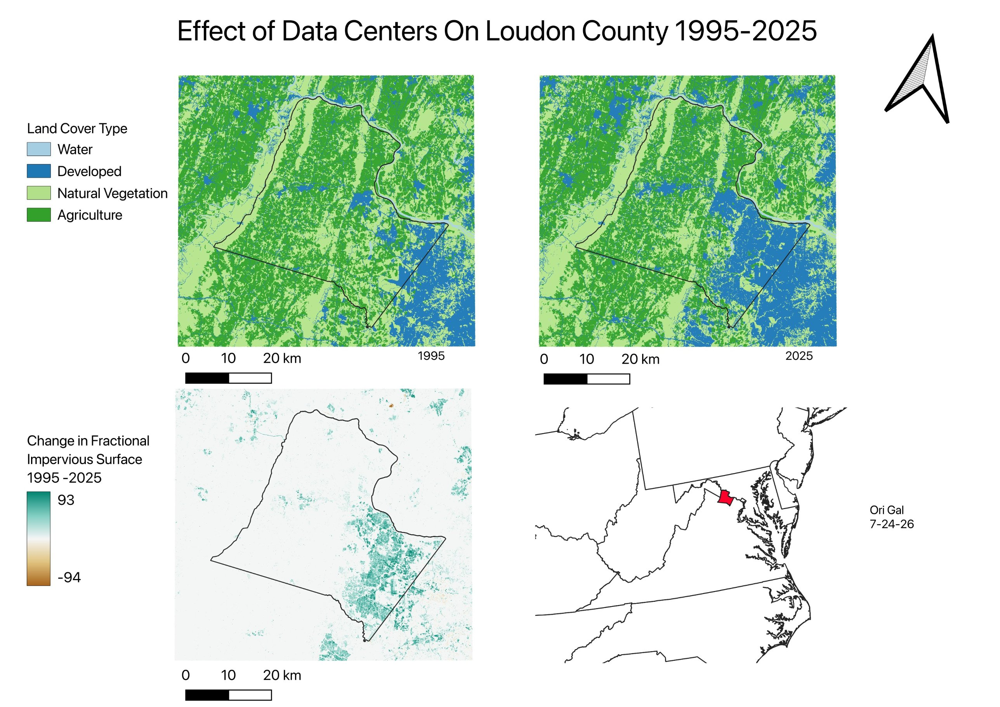
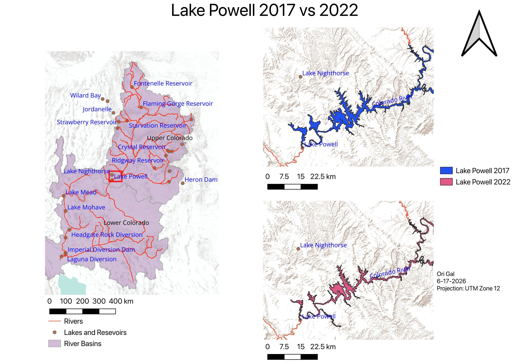
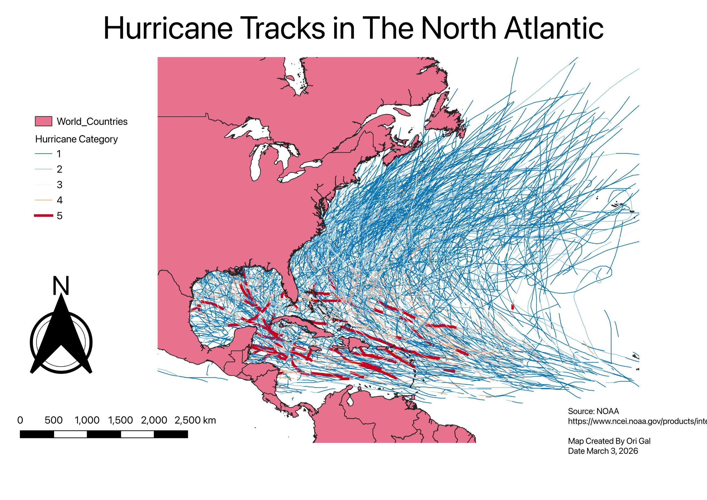
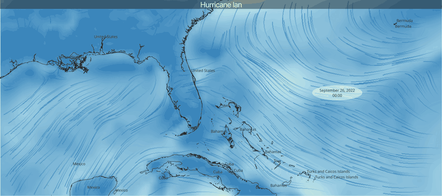
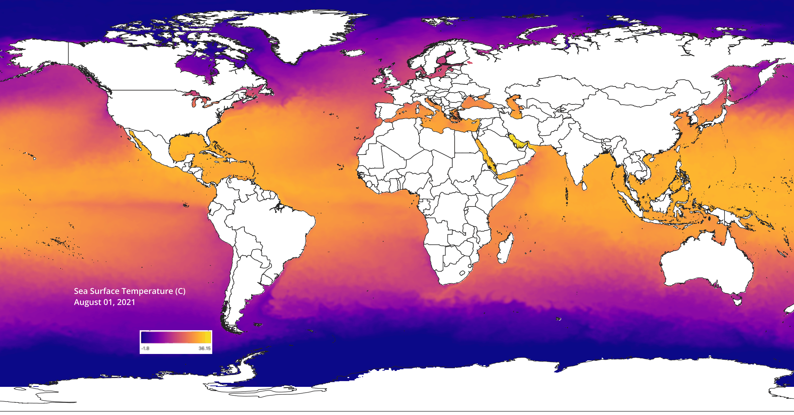
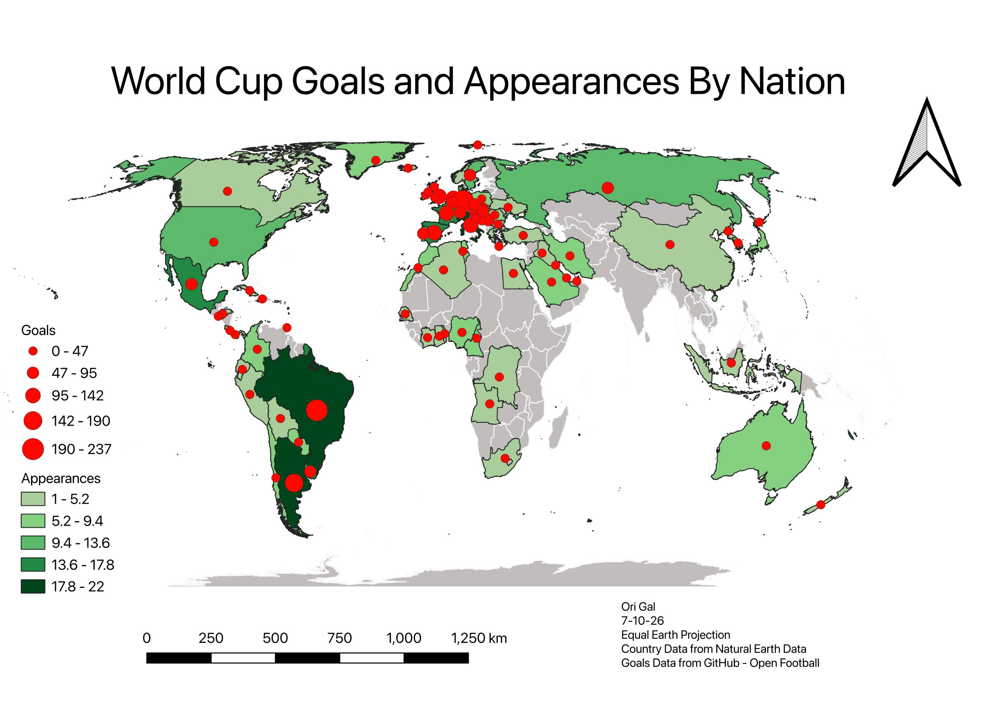

# GIS Portfolio
**Ori Gal** · Ecology & Evolutionary Biology, University of Colorado Boulder
Minors in Geography and Environmental Studies

Maps and spatial analyses from coursework. Tools: QGIS, ArcGIS Online, ArcGIS StoryMaps

---

## Featured Projects

### [Building Into the Burn: Population Growth and Wildfire Exposure in Colorado](https://storymaps.arcgis.com/stories/d1f409862eba49a894e2beb7ab1f88d0)
County-level overlay of population change (2014–2024) and wildfire exposure across Colorado.

### [The Vanishing Forests: Bull Kelp Decline on the California North Coast](https://storymaps.arcgis.com/stories/d6ea87d420ce4c45b23746d422b7c8b2)
StoryMap with an interactive web map of kelp canopy loss (2008–2017) and an animation of sea surface temperature anomalies during the 2013–2016 marine heatwave.

---

## Maps

### Land Cover Change and Data Center Growth in Loudoun County, VA (1995–2025)

Land cover comparison of 1995 and 2025 with a raster of change in fractional impervious surface. Development expanded rapidly across eastern Loudoun County, one of the world's largest data center hubs, largely replacing agricultural and natural land.
**Methods:** land cover reclassification, raster change detection

### Lake Powell Reservoir Extent, 2017 vs. 2022

Overview of the Upper and Lower Colorado River Basins, with major rivers and reservoirs, and a comparison of Lake Powell's surface extent before and during the 2020s drought.
**Projection:** UTM Zone 12N · **Methods:** basin mapping, multi-year reservoir extent comparison

### Hurricane Tracks in the North Atlantic

Historical North Atlantic hurricane tracks classified by Saffir–Simpson category, showing Category 5 storms concentrated in the Caribbean and Gulf of Mexico.
International Best Track Archive (IBTrACS)

### Hurricane Ian Wind Field Animation (September 2022)

Animated wind field of Hurricane Ian approaching and making landfall in southwest Florida.

### Global Sea Surface Temperature

Animated global sea surface temperature (°C), ranging from −1.8 °C in polar waters to over 36 °C in the Persian Gulf and Red Sea.

### World Cup Goals and Appearances by Nation

Graduated symbols for total World Cup goals over a choropleth of tournament appearances, highlighting the dominance of South American and European nations.
**Data:** Natural Earth; openfootball (GitHub) · **Projection:** Equal Earth
